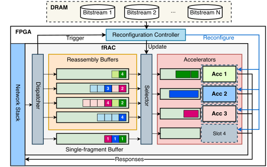

# fRAC: Remote Accelerator Calls on Hostless FPGAs

fRAC lets clients invoke accelerators on an FPGA directly over the network, with no host CPU or software in the invocation path. Built on top of a network stack, it reassembles application-level requests from the incoming byte stream, dispatches them to virtualized accelerator slots, and returns the results, all in hardware. Accelerators follow a run-to-completion model, finishing each request before taking the next. The design is transport-agnostic, but it requires reliable, in-order delivery; the current implementation uses EasyNet, a TCP/IP stack for FPGAs.

fRAC supports 100 Gbps and has been evaluated on an AMD Alveo U280, where it adds minimal overhead. Accelerator slots can be swapped at runtime: a built-in reconfiguration controller accepts partial bitstreams over the network, stores them in HBM, and streams them reconfigure individual accelerator slots.

<p align="center">
  
</p>

## Prerequisites

Vitis HLS and Vivado are required to build the design. fRAC has been tested with version 2022.2 of these tools. Newer versions are expected to work but have not been tested.

We use CMake to build the Vitis HLS components and a separate build tool to build the complete design. The build tool also exports abstract shells, which can be used to generate partial bitstreams for accelerators without rebuilding the entire design. fRAC also requires a valid license for the UltraScale+ Integrated 100G Ethernet Subsystem.

## Quick Start

Clone the repository and enter its directory:

```sh
$ git clone https://github.com/accl-kaust/frac.git
```

With Vitis HLS and Vivado available in your environment, build the network IP
cores and then the complete fRAC design:

```sh
$ make ip CMAKE=/usr/bin/cmake
$ ./bin/spinhdl weave spinhdl.yaml --parallel 8 \
    --units spin.yaml \
    --static static.yaml
```

Set `CMAKE` to the path of your CMake executable if it differs from the one
above. The build generates the full bitstream at
`build/frac/bitstreams/jtag/frac.bit` and abstract shells in
`build/frac/abstract_shell/`.

The script uses Vivado 2022.2 from `/tools/Xilinx/Vivado/2022.2` by default.
Set `VIVADO_ROOT` if Vivado is installed elsewhere.

## Accelerator Examples

Example accelerators are provided in
[kernels/user_krnl/apps](kernels/user_krnl/apps), including Top-K selection,
min-max normalization, the logit transform, and CNN inference.

To add an accelerator, follow the
[accelerator integration guide](docs/adding-an-accelerator.rst), which describes
the required interfaces and how to build a partial bitstream against an
abstract shell.

## Reconfiguring Accelerators

The [reconfiguration script](scripts/reconfslots.go) sends a partial bitstream
to HBM over TCP and send's a command to fRAC's reconfiguration controller to load it
through ICAP. For example, to reconfigure slot 0:

```sh
$ go run ./scripts/reconfslots.go \
    -addr 172.24.1.52:2888 \
    -slot 0 \
    -chunk-size 256 \
    -hbm-addr 0x10004000 \
    -query-status \
    /path/to/partial.bin
```

Replace the address with the FPGA's TCP endpoint and `/path/to/partial.bin`
with the ICAP-format `.bin` file for the target slot. PR Regions 0-3 correspond to
cells C00-C03. The partial bitstream must be built for that region using an
corresponding region's abstract shell.

## Publication

If you use fRAC, do cite us

```bibtex
@inproceedings{yang2026frac,
  author    = {Ziyi Yang and Krishnan B. Iyer and Yixi Chen and Ran Shu and Zsolt Istv{\’a}n and Marco Canini and Suhaib A. Fahmy},
  title     = {{fRAC}: {R}emote {A}ccelerator {C}alls on Hostless {FPGA}s},
  booktitle = {Proceedings of the 2026 ACM SIGOPS Annual Technical Conference},
  series    = {SIGOPS ATC ’26},
  year      = {2026},
  month     = nov,
  address   = {Hong Kong},
  publisher = {ACM},
  doi       = {10.1145/3828523.3857070},
  isbn      = {979-8-4007-2818-1},
  url       = {https://doi.org/10.1145/3828523.3857070},
}
```

## License

fRAC is released under the [MIT License](LICENSE).
